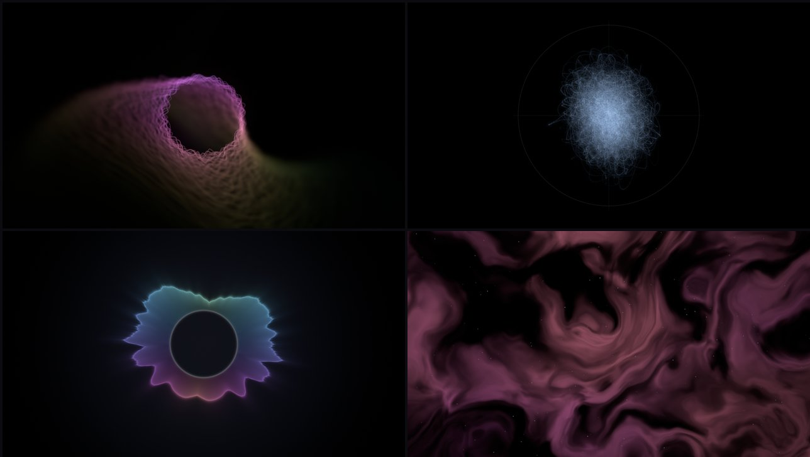
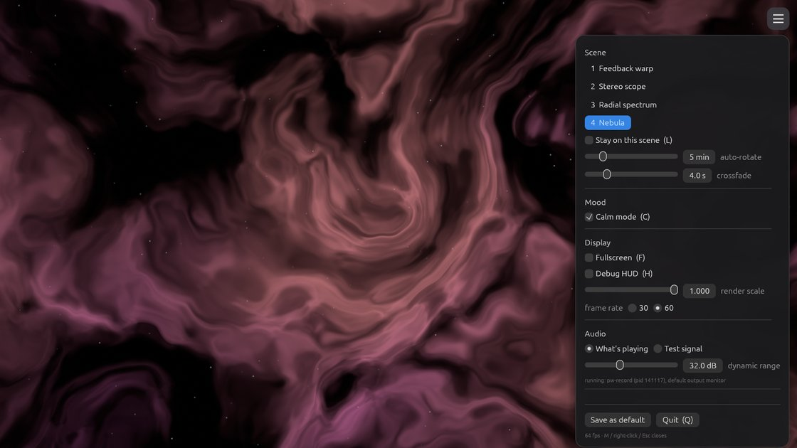

# miz

A native music visualizer for Linux (PipeWire), built for calm "music
meditation": feedback warps, a stereo scope, a radial spectrum and a nebula
that react to whatever your system is playing — Spotify, a browser, anything.



- Captures **only the monitor of the default output** (what you hear), never a
  microphone — Bluetooth earbuds stay in their high-quality profile, and other
  apps (video calls) keep their mic.
- No daemons, no system audio configuration: it runs `pw-record`, which ships
  with PipeWire.
- Calm mode by default, and a GPU **photosensitivity limiter** in every mode:
  the picture's average brightness can't change fast enough to flash.
- Rust + wgpu (Vulkan), ~13% of one CPU core at 72 fps on a laptop iGPU,
  half the frame rate when nothing is playing. A small settings menu (egui)
  for everything that has a shortcut or a config option.

## Build and install

Needs a Rust toolchain (`rustup`), a C linker (`gcc`) and PipeWire with
`pw-record` (Ubuntu: `pipewire-bin`, installed by default). No dev headers:
windowing and Vulkan are loaded at runtime.

```sh
cargo build --release          # binary: target/release/miz
scripts/install.sh             # per-user install, no sudo
scripts/install.sh --uninstall
```

`install.sh` puts the binary in `~/.local/bin`, a launcher entry in
`~/.local/share/applications` and the icon in `~/.local/share/icons`.
The app ID (desktop file, icon, AppStream metainfo, Wayland app_id) is
`com.antonjoy.miz`.

### Packages

- **.deb** — `cargo install cargo-deb`, then `cargo deb` builds
  `target/debian/miz_<version>-1_amd64.deb` (binary in `/usr/bin`, desktop
  file, icon, metainfo; depends on `pipewire-bin`). It needs the glibc of
  the system it was built on or newer, so build on the oldest Ubuntu you
  want to support.
- **Flatpak** — `packaging/flatpak/com.antonjoy.miz.yml` (freedesktop
  runtime 26.08, which ships `pw-record`; crates vendored in
  `cargo-sources.json` for the offline build). With `org.flatpak.Builder`
  from Flathub:
  `flatpak run org.flatpak.Builder --user --install --force-clean packaging/flatpak/build packaging/flatpak/com.antonjoy.miz.yml`.
  The only audio permission is the PipeWire socket
  (`xdg-run/pipewire-0`, read-only); the config lives in
  `~/.var/app/com.antonjoy.miz/config/miz/`.

## Usage

Move the mouse and a **☰ button** appears in the top-right corner; it (or
`M`, or a right-click) opens the settings menu: scene, auto-rotation, calm
mode, fullscreen, quality, audio source and sensitivity, flash-safety limits.
Changes apply immediately; **Save as default** writes them (and the current
scene) to the config file, keeping its comments.



```sh
miz                      # visualize the default output
miz --source test        # built-in synthetic music (no PipeWire needed)
miz --scene nebula --hud
miz --menu               # start with the settings menu open
miz --debug-audio        # terminal dashboard of the audio analysis, no window
miz --dev                # load shaders from the source tree, reload on save
miz --help
```

| Key | Action |
|---|---|
| `M` | settings menu (also right-click or the ☰ button) |
| `F` | fullscreen (the cursor hides after 3 s) |
| `N` / `P` | next / previous scene (4 s crossfade) |
| `1`–`4` | feedback warp, stereo scope, radial spectrum, nebula |
| `L` | lock the current scene (no auto-rotation) |
| `C` | calm mode on/off |
| `H` | debug HUD; FPS and gain are in the window title |
| `Q` / `Esc` | quit (`Esc` closes the menu first) |

Shortcuts use physical key positions, so they work with any keyboard layout.

The HUD shows the 64 bands on the left and, on the right from the top: bass,
low-mid, high-mid, treble, loudness, stereo width, auto-gain level, and the
safety limiter's activity (empty when it isn't intervening). The dot in the
corner is the beat pulse.

## Configuration

`~/.config/miz/config.toml` is created on first run with every option
documented. Edits apply while miz is running (except `gpu`); a file with an
error is rejected and the previous settings stay. `--source` and `--scene`
on the command line override the file. The menu's **Save as default** writes
here too.

```toml
[audio]
source = "pipewire"          # or "test"
bands = 64                   # 8..128 log-spaced bands, 30 Hz .. 16 kHz
tilt_db_per_octave = 4.5     # compensates music's bass-heavy slope
range_db = 32.0              # dynamic range shown below the auto-gain level
attack_ms = 15.0             # band smoothing
release_ms = 250.0
gain_decay_db_per_s = 2.0    # auto-gain recovery speed

[visual]
calm = true                  # start in calm mode
scene = "feedback"           # feedback, lissajous, radial, nebula, bass-pulse
rotate_minutes = 5.0         # 0 = never
lock = false                 # stay on the current scene (L)
crossfade_seconds = 4.0
render_scale = 1.0           # 0.25..1.0 internal resolution
target_fps = 60.0            # actual rate = refresh / N closest to this
gpu = "low-power"            # or "high-performance" (needs restart)
fullscreen = false           # start in fullscreen (F)

[safety]
max_brightness_rate = 0.25       # can be lowered, never raised
calm_max_brightness_rate = 0.12

[dev]
shader_dir = ""              # load shaders from here and hot-reload them
```

## How it works

### Audio pipeline

```
pw-record (child process)          stream.capture.sink=true -> monitor of the default output
  │ raw f32 stereo @ 48 kHz          (WirePlumber re-links it when the default output changes)
  ▼
reader thread ──► audio thread: ring buffer, every 512 new frames (~10.7 ms):
                    Hann window -> 2048-point FFT -> power spectrum
                    -> 64 log-spaced bands (dB, spectral tilt)
                    -> auto-gain: dB relative to a slowly decaying peak -> 0..1
                    -> asymmetric smoothing (fast attack, slow release)
                    -> bass / mids / treble / loudness / stereo width
                    -> spectral-flux onsets, adaptive median threshold -> beat pulse
                    -> silence detection -> idle factor
                  ──► Snapshot (published with try_lock: the renderer never waits)
render thread:    per-frame smoothing + calm/energetic shaping
                  -> uniform buffer (features, time, beat) + storage buffers (bands, waveform)
```

If `pw-record` exits it is restarted with exponential backoff; if it isn't
installed, the window title says so and the visuals idle. Gaps in the audio
are treated as silence, so the picture fades into its idle animation instead
of freezing.

### The feedback loop

The heart of the MilkDrop style. Two HDR (`Rgba16Float`) textures take turns:
each frame draws the *previous* frame back, slightly zoomed (bass), rotated
(mids), swirled, displaced by a slow wave field, blurred, darkened and
hue-shifted — then the fresh waveform is drawn on top as a ring. Repeating
tiny transformations 72 times a second turns one line into tunnels and
smoke. Half-float targets keep slow fades smooth (8-bit fades get stuck and
leave burnt-in pixels). All rates are per second, so the look doesn't depend
on the frame rate. See `shaders/feedback_warp.wgsl`.

### Safety limiter

After the scene is rendered, a compute shader sums its luminance (workgroup
reduction + an atomic counter) and a second pass moves the *allowed* average
brightness towards the real one by at most `max_brightness_rate` per second.
The present pass multiplies the image by allowed/real in the same frame. A
10% swing then takes at least 0.4 s each way — at most ~1.25 such flashes per
second, well under the 3/s guideline — and a test full-screen 5 Hz strobe
ends up under a 4% swing. Scenes are also designed to keep beat reactions
small and smooth. See `shaders/luma.wgsl`.

## Development

- `cargo test` — analysis (band placement, silence, auto-gain, onsets), config
  template, shader validation, uniform layout.
- `cargo run --release -- --dev` — edit any `shaders/*.wgsl` and save; it is
  validated with naga and swapped in. Errors print as `file:line: message` and
  the previous shaders keep running.
- `--capture out.ppm --capture-after 5 [--capture-frames N]` saves exactly
  what is shown, for checking changes without watching the screen.
- `RUST_LOG=miz=debug` prints FPS and status once a second.

```
src/
  audio/      pw-record source, test signal, ring buffer, engine thread
  analysis/   FFT, bands, auto-gain, smoothing, onset detection
  render/     frame params (uniforms), safety limiter, frame graph
  scenes/     feedback, scope, shader scenes, scene manager (crossfades)
  gpu/        device/surface, pipelines, shader library (naga validation)
  app.rs      window, keys, frame pacing, hot reload, applying settings
  menu.rs     settings menu (egui, immediate mode)
  config.rs   config file
shaders/      WGSL; common.wgsl is prepended to every shader
```

## License

MIT — see [LICENSE](LICENSE).
